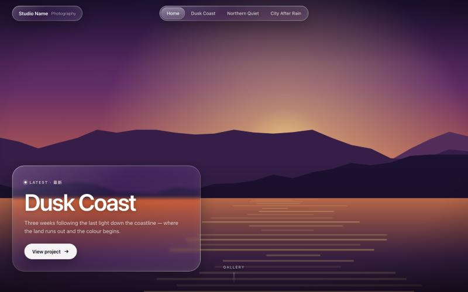
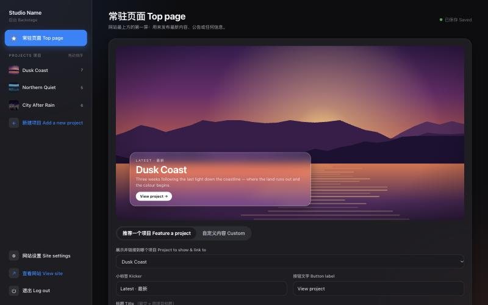
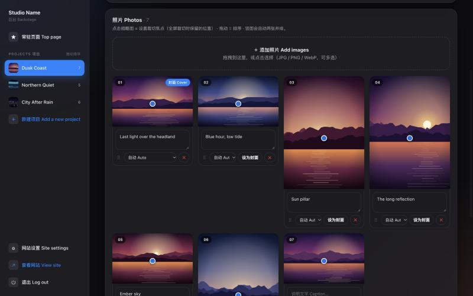
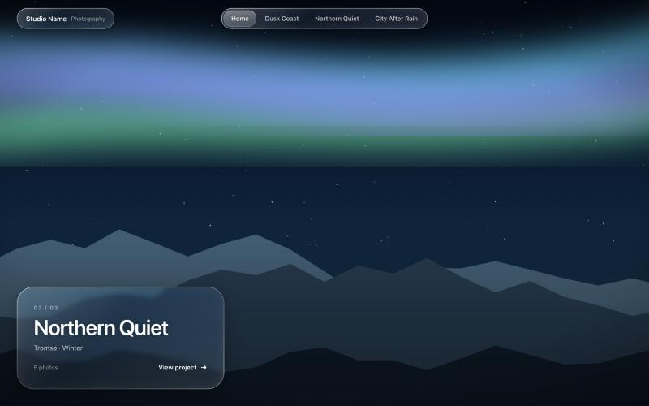
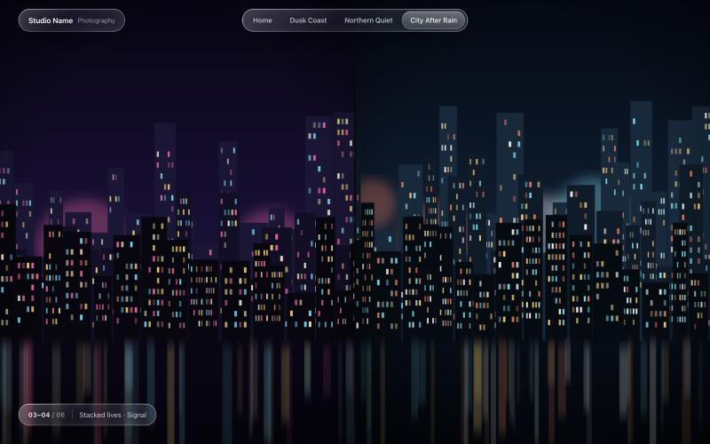
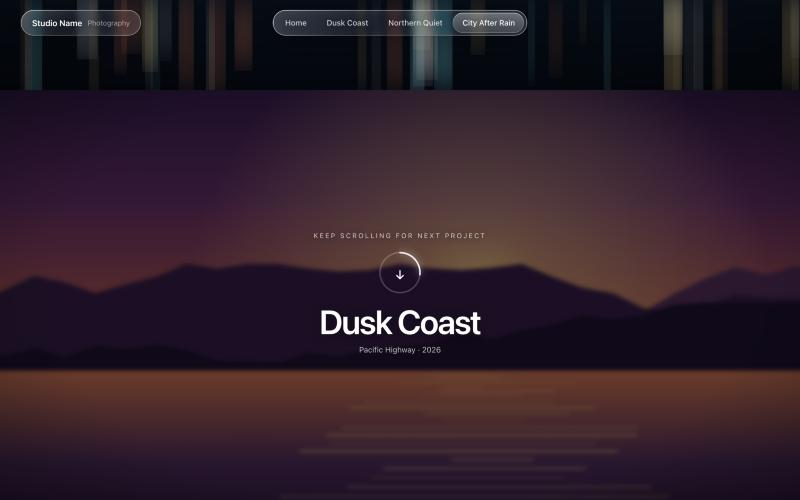

# 摄影网站 · 使用说明

一个 Liquid Glass 风格的全屏摄影网站 + 一个给你自己用的后台。
不需要安装任何东西（用 Mac 自带的 Python）。

| 网站 | 后台 |
|---|---|
|  |  |

---

## 1 · 打开后台（每次改内容都从这里开始）

1. 在 Finder 里**双击 `start.command`**。
   （第一次如果提示无法打开：右键 → 打开。）
2. 浏览器会自动打开后台：<http://localhost:4173/admin>
3. **第一次**会让你创建一个后台密码，之后用它登录。
4. 网站预览：<http://localhost:4173>
5. 用完后关掉那个终端窗口即可。

> 也可以在终端里运行：`python3 server.py`

---

## 2 · 管理内容

所有修改都会**自动保存**（右上角显示「已保存 Saved」）。

### 常驻页面 Top page —— 网站最上面的第一屏

- **推荐一个项目**：选一个项目，第一屏就显示它的封面并链接过去。标题/正文留空 = 自动用项目的。
- **自定义内容**：自己写标题、正文、按钮、上传背景图 —— 用来发公告、展览信息、任何 mention。
  按钮链接可以是外部网址，也可以是站内项目（`#/p/项目的slug`）。
- 上方的预览图会实时显示效果。

### 项目 Projects

| 我想… | 怎么做 |
|---|---|
| 新建项目 | 左侧 **＋ 新建项目 Add a new project** |
| 加照片 | 把照片拖进虚线框，或点击它选择（可多选，JPG / PNG / WebP） |
| 写说明文字 | 每张照片下面的输入框 |
| 换封面 | 照片上的 **设为封面** |
| 控制全屏裁切保留哪里 | **点击缩略图**，蓝点 = 裁切时保留的焦点 |
| 让某张照片一定全屏 | 显示方式选 **Fill** |
| 让某张照片一定带白边、不裁切 | 显示方式选 **完整显示 Fit** |
| 让某张照片横向铺满屏幕、不裁切 | 显示方式选 **铺满横屏 Full width**（高度跟随照片比例，停下时照片中心会轻轻对齐屏幕中心） |
| 调整项目顺序 | 在左侧列表里拖动项目 |
| 暂时隐藏项目 | 关掉 **在网站上显示 Published** |
| 删除 | 照片上的 ✕ / 页面底部的 **删除这个项目** |
| 时间叠图（同一地点不同时间） | **＋ 时间叠图 Image stack**，一次选好整组照片（按文件名排序）。每一层可以写时间标签，小图可拖动换顺序。网站上画面会固定住，随滚动从一张渐变到下一张 |
| 加视频 | **＋ 视频文件 Video file**（MP4 / MOV / WebM，最大 95 MB），或 **＋ YouTube 链接**。进入画面时静音自动播放 |
| 调整顺序 | 按住卡片空白处直接拖动，松手后自动保存 |

照片上传时会自动压缩到最长边 5120px，原图不会被修改。
视频不会被压缩：超过 95 MB 请先用 HandBrake 或 iMovie 导出 1080p（GitHub 不接受超过 100 MB 的文件）。
iPhone 拍的 HEVC 视频在部分浏览器里放不了，建议导出为 H.264（"兼容性最佳"）。
iPhone 的 HEIC 格式请先导出成 JPG。

> 现在网站里的三个项目是**演示用的占位图**，放上自己的作品后在后台删掉即可。
> 网站名称、页脚、邮箱在 **网站设置 Site settings** 里改。
> 首页第一屏下方那段大字（引言）也在这里：**首页引言 Intro**。

---

## 3 · 发布到网上（免费，GitHub Pages）

你的电脑上已经有 **GitHub Desktop**，用它最简单。只有第一次需要设置：

**第一次**

1. 打开 GitHub Desktop → `File` → `Add Local Repository…` → 选这个 `PhotographyWEB` 文件夹
   → 它会提示"不是仓库"，点 **create a repository** → `Create Repository`。
2. 点 **Publish repository**。**取消勾选** "Keep this code private"（免费账号的 GitHub Pages 需要公开仓库）。
3. 打开 github.com 上的这个仓库 → `Settings` → `Pages` → **Source** 选 **GitHub Actions**。
   > 第 2 步发布时 GitHub 会立刻尝试部署，但那时 Pages 还没打开，所以**第一次一定会失败**，并发一封 "Run failed" 邮件，这是正常的。
   > 做完这一步后，到仓库的 `Actions` → 左边点 **Deploy site** → 右边 **Run workflow** → **Run workflow**，重新部署一次即可。
4. 等 1–2 分钟，`Settings → Pages` 页面顶部会出现你的网址：
   `https://你的用户名.github.io/仓库名/`

**以后每次更新网站**

1. 双击 `start.command`，在后台改内容。
2. 打开 GitHub Desktop → 左下角写一句说明 → **Commit to main** → **Push origin**。
3. 1–2 分钟后线上网站自动更新。

> 想用自己的域名：`Settings → Pages → Custom domain` 填入域名，再按提示到域名商那里加一条 CNAME 记录。

**其他托管方式**

- **Netlify / Cloudflare Pages**：连接同一个 GitHub 仓库，把 *Publish / Output directory* 设为 `public`，不需要 build 命令。
- **想在任何地方登录后台（不只在自己电脑上）**：把整个项目放到一台能跑 Python 的服务器上，
  用 `HOST=0.0.0.0 ADMIN_PASSWORD=你的密码 python3 server.py` 启动，并在前面加 HTTPS（如 Caddy / Nginx）。
  这种方式下不需要 GitHub，后台保存即上线。

---

## 4 · 网站长什么样

| | |
|---|---|
|  向下滚动进入 Gallery，每个项目一整屏 |  项目内：全屏照片，竖图自动并排，左下角是说明 |
|  滚到底继续滚 → 圆环蓄力 → 进入下一个项目 | 顶部玻璃导航条可随时切换项目 |

---

## 5 · 常见问题

- **忘记后台密码**：删除项目文件夹里的隐藏文件 `.admin.json`（Finder 按 `⌘⇧.` 显示隐藏文件），再打开后台重新创建。
- **改错了想恢复**：每次保存前都会备份到隐藏文件夹 `.backups/`，把其中一个文件复制回 `public/data/content.json`。
- **线上没更新**：确认 GitHub Desktop 里已经 Push；到仓库的 `Actions` 页看部署是否完成；浏览器强制刷新（`⌘⇧R`）。
- **玻璃的折射效果**：Chrome / Edge / Arc 有完整的边缘折射；Safari / Firefox 显示为磨砂玻璃（浏览器限制）。
- **想换回旧版外观（v1，全黑、每张照片全屏）**：旧版保存在 `versions/v1-liquid-glass/`，恢复方法见里面的 `README.md`。
  截图（本页的图片）是 v1 时拍的，现在的版本多了白色留白页面和衬线字体。
- **手机版**：目前能正常浏览，专门的手机适配还没做。

文件结构和技术细节见 [AGENTS.md](AGENTS.md)。
